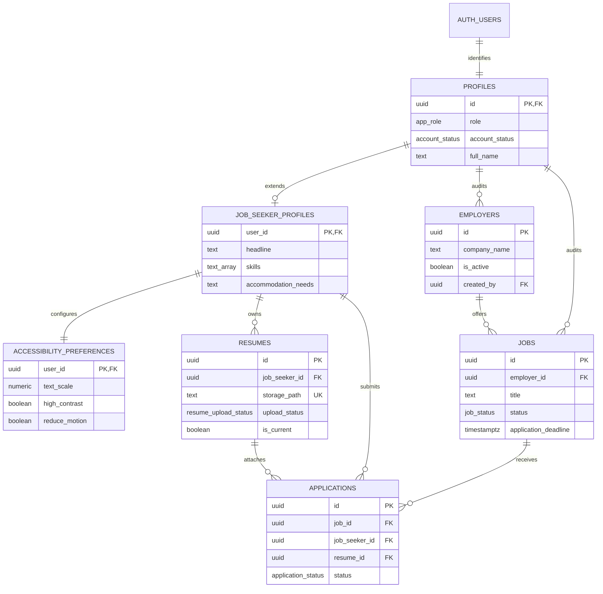

# Phase 1 database design

The owner approved the Phase 1 design and local implementation. The original Phase 0 requirements are the authorized scope source; the final agreement/SOW was not attached. Exactly two application roles exist: PWD Job Seeker and System Administrator. Employers are company records with no Auth identity, login, dashboard or self-service publishing.

## Entity relationship diagram

The application/resume relationship additionally uses a composite foreign key (resume_id, job_seeker_id) to enforce resume ownership. Audit relationships are abbreviated. auth.users and storage.* are managed by Supabase and are not recreated by migrations. Test doubles live only under tests/support/.

## Schema dictionary

All application IDs are UUIDs. Mutable records use timestamptz created_at/updated_at. Defaults, bounds, ownership constraints, and policies are executable in the five migrations, which are the exact schema source.

| Table | Columns and responsibility |
| --- | --- |
| profiles | id PK/FK auth.users; role enum; full_name <=120; optional phone <=32; account_status enum; timestamps. Login email/password are managed only by Auth. |
| job_seeker_profiles | user_id PK/FK profiles; headline, summary, city, province, education_summary, experience_summary; skills, preferred_job_types, preferred_work_arrangements arrays; optional accommodation_needs; timestamps. No diagnosis, PWD card, medical certificate or sensitive identity-document collection. |
| accessibility_preferences | user_id PK/FK seeker; text_scale 0.80-2.00; high_contrast/reduce_motion booleans; timestamps. Defaults created at signup. |
| employers | id; company_name, description, website_url, city, province; is_active; created_by/updated_by profile FKs; timestamps. No private employer contact fields are mixed into seeker-visible records. |
| jobs | id; employer_id FK; title, description, qualifications, required_skills; employment_type, work_arrangement, city, province; nullable salary_min/salary_max with nonnegative ordered bounds; currency; accessibility_details; status, published_at, application_deadline; audit actors; timestamps. |
| resumes | id; job_seeker_id FK; title; storage_bucket fixed to resumes; storage_path fixed to owner/id/resume.pdf and unique; mime_type fixed to application/pdf; size_bytes 1-5,242,880 when ready; upload_status; is_current; timestamps. Composite unique(id,job_seeker_id); partial unique current resume per owner. |
| applications | id; job_id FK; job_seeker_id FK; resume_id with ownership composite FK; status; submitted_at; status_updated_at/status_updated_by; updated_at. Unique(job_id,job_seeker_id). |

Enums: app_role=(job_seeker,system_administrator); account_status=(active,suspended); job_status=(draft,published,inactive); application_status=(submitted,under_review,shortlisted,rejected,hired); resume_upload_status=(pending,ready,failed,deleting). The internal deleting state coordinates non-atomic Storage/metadata deletion; it is not a new user feature or role.

Employment types: full_time, part_time, contract, internship. Work arrangements: onsite, remote, hybrid. Skills remain bounded arrays for this small scope; no separate taxonomy service or vector database is introduced.

## Integrity and lifecycle

- Signup trigger ignores client role metadata and creates an active job_seeker plus child/default preference rows. A user cannot insert profiles or modify role/status columns through the API.
- private.bootstrap_administrator is trusted SQL only; PUBLIC, anon, authenticated and service_role execution are revoked. It refuses accounts already carrying resumes/applications and removes unused seeker-only rows before promotion. No frontend or general admin promotion endpoint exists.
- Application references are immutable to clients. Only submit_application can insert; only set_application_status can change status. Unique constraints arbitrate duplicate submissions.
- Status transitions: submitted -> under_review/rejected; under_review -> shortlisted/rejected; shortlisted -> hired/rejected. Terminal statuses cannot reopen.
- Publishing and submission lock employer before job; submission then locks resume. Employer IDs are not client-updateable. Deactivation and concurrent submission therefore serialize; multi-connection runtime testing is still required.
- Jobs with applications cannot return to draft. Historical jobs/company records remain readable to their actual applicants when closed. No public/anonymous job browsing is enabled.
- Referenced employers/jobs/resumes are retained using restrictive foreign keys. Deactivate rather than delete. Auth deletion can be blocked by retained records; no cascading frontend account-deletion feature is provided. Review retention and remove Storage objects before any future controlled account purge.
- RLS-relevant columns are indexed; application job_id is covered as the leading column of the unique(job_id,job_seeker_id) index.

## Future AI

No AI tables, embeddings, API calls, credentials or billing setup are created. Phase 6 may add owner-scoped ai_requests, career conversations/messages, resume analyses and job-match results after agreeing payloads and retention. References will use existing seeker/resume/job IDs; administrator access to conversations will not be assumed.

## Migration order

1. 20261108000100_identity.sql: enums, profiles/seeker/preferences, signup trigger, role helpers, identity RLS and column grants.
2. 20261108000200_employment.sql: companies/jobs, validation, indexes, audit triggers and administrator write policies.
3. 20261108000300_resumes_applications.sql: resume/application constraints, indexes and read policies with recursion-safe helpers.
4. 20261108000400_controlled_operations.sql: narrowly granted transactional operations and SQL-only administrator bootstrap.
5. 20261108000500_private_storage.sql: private bucket, Storage policies, server-only finalization and coordinated deletion.

No policy-free hosted deployment is authorized. Replay the complete sequence locally; intermediate migrations are not a supported application state. Later schema changes should be new reviewed migrations after this set is approved/applied.
